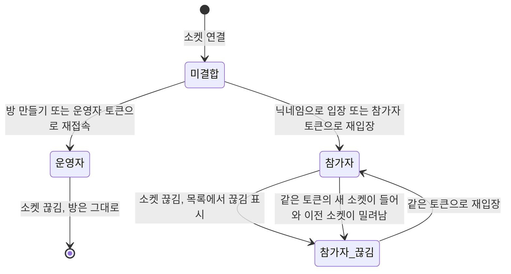
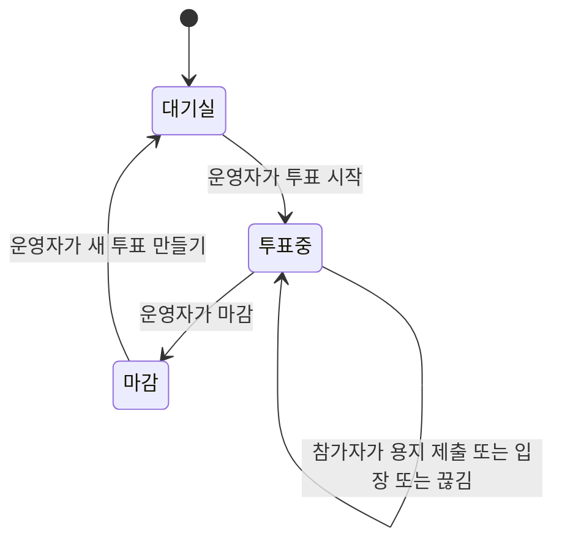
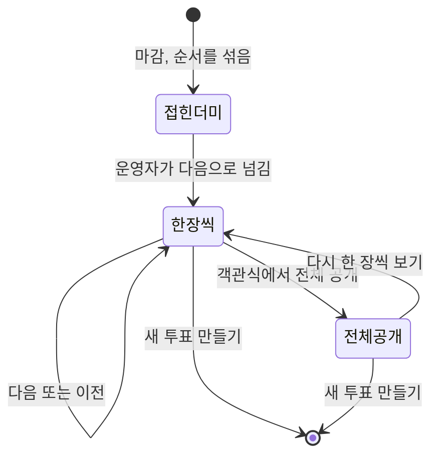

# 익명 투표 웹앱 — 플랜

- 최종 갱신: 2026-11-16
- 상태: 6단계(마무리) 완료, 7단계(배포) 준비 완료. 남은 것은 사용자 계정에서 Render 연결
- 운영 규칙: 결정이 바뀌면 이 파일의 해당 Decision을 고치고, 맨 아래 "변경 이력"에 한 줄 남긴다.

## 1. 무엇을 만드나

운영자가 방을 만들고, 참가자가 QR 또는 4자리 코드로 폰에서 입장한다. 운영자가 투표(제목, 용지 유형, 익명/기명)를 정해 시작하면 참가자는 폰에서 종이 용지에 투표하고, 용지를 접어 투표함에 넣는 연출과 함께 제출한다. 운영자가 마감하면 용지를 한 장씩 펼쳐 확인한다. 운영자 폰과 대화면 모두에서 볼 수 있다.

사용 상황: 한 공간에 모인 30~50명(수업, 회의, 모임). 운영자 노트북을 프로젝터에 연결하거나 폰으로 진행한다.

## 2. Decisions

상태: 확정 / 제안(확인 필요)

### 용지와 투표
- **D-01 용지는 두 종류** (확정): 자유 기재형(쓰기 또는 타이핑)과 객관식(운영자가 정한 보기 2~8개, 단일 선택). 복수 선택과 "기타 직접 쓰기"는 1차에서 제외.
- **D-02 한 방에서 투표 여러 번** (확정): 순서대로 진행하고 동시에 열리는 투표는 하나. 매 투표마다 제목, 용지 유형, 익명/기명을 새로 정한다.
- **D-03 쓰기와 타이핑은 둘 다 허용, 참가자가 전환** (확정): 운영자가 제한하는 옵션은 없다.
- **D-04 제출 규칙** (확정): 마감은 운영자 수동. 제출 후 수정과 취소 불가(1인 1표). 빈 용지 제출 불가. 제출 직전에 "제출하면 고칠 수 없어요" 확인 한 단계. 타이머와 자동 마감은 1차에서 제외.

### 방과 참가자
- **D-05 입장** (확정): 운영자 화면의 QR 또는 4자리 방 코드로 입장하고 닉네임을 입력한다. 계정은 만들지 않는다. 대기실에는 참가자 닉네임이 실시간으로 뜬다.
- **D-06 운영자** (확정): 계정 없이 호스트 토큰으로 식별하고 새로고침해도 유지한다. 투표에는 참여하지 않는다.
- **D-07 참가자 관리와 접속 안정성** (확정): 폰 재접속 시 참가자 토큰으로 자리와 작성 중 초안을 복구한다. 투표가 열린 동안 늦게 입장해도 참여할 수 있다(진행 현황의 분모는 현재 참가자 수). 방 안에서 닉네임 중복 불가, 운영자가 참가자를 내보낼 수 있다. 4자리 코드는 조합이 1만 개라서, 진행 중인 방끼리 코드가 겹치지 않게 하고 틀린 코드를 반복 입력하면 잠시 막는다.

### 익명/기명과 공개
- **D-08 익명의 정의** (수정됨, 확정): 익명이냐 기명이냐는 공개 단계에서 용지와 결과에 닉네임을 표시하느냐의 차이다. 서버는 익명이어도 작성자를 저장하고 운영자는 누가 썼는지 알 수 있다(D-27). 기명이면 용지 하단에 닉네임이 서명처럼 찍히고, 익명이면 어떤 공개 화면에도 닉네임이 나오지 않는다. 모드는 투표 시작 후 바꿀 수 없다. 참가자 폰에는 쓰기 전에 모드 배지를 크게 표시한다. 문구는 "공개 화면에 이름이 표시되지 않아요" 수준으로 정확하게 쓰고, "완전 익명"이라고 단정하지 않는다.
- **D-09 용지 공개 순서는 항상 무작위** (확정): 제출 순서로 보여주면 누가 먼저 냈는지로 추측할 수 있다.
- **D-10 진행 현황** (확정): 운영자 화면에는 "제출 32/45"와 미제출자 닉네임 목록을, 대화면에는 숫자만 보여준다. 마감 전에는 용지 내용을 누구도 볼 수 없다.

### 결과 확인
- **D-11 결과 확인 흐름** (확정): 마감하면 접힌 용지 더미가 나오고, 탭, 스페이스, 방향키로 한 장씩 펼친다. 이전과 다음으로 넘길 수 있다. 자유 기재형은 "전체 공개" 없이 한 장씩만 확인한다.
- **D-12 객관식 결과** (수정됨, 확정): 기본은 한 장씩 공개한다. "전체 공개"를 누르면 보기별 득표 그래프를 보여준다. 한 장씩 공개하는 동안에는 누적 막대를 띄우지 않는다.
- **D-13 대화면 전용 링크는 1차에 포함** (수정됨, 확정): 운영자 화면의 "대화면 열기"에서 링크와 QR을 만든다. 보기 전용이고, 방마다 대화면 토큰으로 막아 방 코드만으로는 들어올 수 없다. 여러 대화면이 동시에 접속해도 된다. 대기실에는 입장 QR과 참가자 목록, 투표 중에는 제목과 진행 숫자, 결과에서는 운영자가 펼치는 용지가 동기화되어 나온다. 운영자 화면은 폰 세로와 대화면 가로 양쪽에 맞게 반응하고 전체화면 버튼을 둔다.
- **D-14 대화면 가리기** (확정): 운영자 화면에 토글을 둔다. 가림 상태에서는 운영자 화면에는 용지가 보이고 대화면에는 접힌 용지만 보인다. 해제하면 공개된다.

### 입력과 연출
- **D-15 쓰기 모드** (확정): 용지는 세로 3:4 고정(폰과 대화면에서 같은 모양으로 보이게). 검정 펜(굵기 2단계), 지우개, 되돌리기, 전체 지우기. 글씨는 이미지가 아니라 획 좌표로 저장하고 내보낼 때 이미지로 바꾼다. 손가락과 스타일러스 모두 지원.
- **D-16 타이핑 모드** (확정): 최대 200자, 같은 용지 위에 손글씨체 웹폰트(나눔펜 계열)로 표시. 모드별 초안을 따로 보존하고, 제출은 그 순간 선택된 모드의 내용만 들어간다. 용지 하나에 한 모드만 담긴다.
- **D-17 객관식 용지** (확정): 보기가 손글씨체로 적혀 있고, 탭하면 동그라미가 그려지는 애니메이션이 나온다. 제출 연출은 자유 기재형과 같다.
- **D-18 용지와 애니메이션** (확정): 크림색 종이에 은은한 괘선과 가장자리 그림자. 접기는 가로 반, 세로 반으로 두 번 접고 위로 올라가 투표함 틈으로 들어가며, 투표함 숫자가 올라가고 짧게 진동한다. 효과음은 넣지 않는다. 펼치기는 투표함에서 꺼내 중앙으로 확대되며 두 번 펼쳐지는, 접기의 역순이다. 모션 줄이기 설정을 켠 기기에서는 간소화한다.

### 데이터
- **D-19 저장은 서버 메모리만** (확정): DB는 쓰지 않고 방은 마지막 활동 후 일정 시간 뒤 자동 삭제한다. 서버가 재시작되면 진행 중인 방은 사라진다. 삭제 시간은 마지막 활동 후 6시간.
- **D-20 내보내기** (수정됨, 확정): 투표 하나 단위로 PDF와 CSV를 제공한다. PDF에는 제목, 날짜, 익명/기명, 객관식 집계가 들어가고 용지가 한 장씩 이미지로 이어진다. CSV에는 타이핑 내용과 객관식 선택을 담는다. 익명 투표는 닉네임을 넣지 않고 기명 투표는 넣는다. 방을 닫거나 자동 삭제되기 전에 "아직 내보내지 않은 투표가 있어요" 경고를 띄운다.

### 기술과 진행
- **D-21 기술 스택** (확정): TypeScript로 프런트(React + Vite)와 서버(Node + WebSocket)를 만들고, 서버 하나가 프런트까지 서빙해 한 곳에 배포한다. 손글씨는 Pointer Events 캔버스, 애니메이션은 CSS 3D와 Framer Motion.
- **D-22 개발 중 폰 테스트** (확정): 노트북에서 서버를 돌리고 `cloudflared` 같은 터널로 임시 주소를 만들어 실제 폰으로 접속한다.
- **D-23 배포는 Render 무료 플랜** (확정): 유휴 시 잠들어도 사용 시점에는 문제없다고 판단. 위험: 잠들거나 재시작되면 메모리의 방이 사라진다. 대응: 행사 전에 주소를 먼저 열어 깨워 두고, 배포 단계에서 유휴 후 동작을 직접 확인한다.
- **D-24 검증** (확정): 서버는 Vitest로 "익명 투표에서 대화면으로 보내는 데이터에 닉네임이 없다", "중복 제출이 막힌다", "방 코드를 반복해서 틀리면 막힌다"를 먼저 테스트로 고정한다. 화면은 Playwright로 운영자 1명, 모바일 크기 참가자 여러 명, 대화면 1개를 동시에 띄워 입장부터 펼치기까지 돌리고, 접기와 펼치기 애니메이션은 스크린샷으로 확인한다.
- **D-25 pstack 사용** (확정): 구현 전에 `pstack:architect`로 타입과 모듈 구조를, `pstack:statechart`로 방과 투표의 상태 전이를 먼저 고정한다. 서버는 `pstack:tdd`, UI와 애니메이션은 직접 보며 다듬고, 각 단계가 끝날 때마다 리뷰를 따로 한 번 돌린다.
- **D-26 플랜 운영** (확정): 이 파일에 결정을 Decision으로 남기고, 바뀔 때마다 갱신한다.
- **D-29 디자인은 A안(투표소)으로 간다** (확정): 구현 전에 디자인 가안 3개를 먼저 만들어 봤고, 사용자가 A안을 골랐다. B와 C에서 가져오는 것은 없다. 가안 목업은 참고용으로 `디자인가안/`에 남긴다. 아래는 가안 제작 기록이다. `디자인가안/` 폴더에 정적 HTML 목업 3개를 만들었다. `디자인가안/index.html`을 열면 된다. 서버 없이 화면만 있고, 용지에 직접 쓰기와 타이핑 전환, 객관식 동그라미, 제출 접기 연출, 한 장씩 펼치기, 익명/기명 미리보기를 눌러 볼 수 있다. 세 가안 모두 D-18(크림색 용지, 두 번 접기, 투표함, 진동, 효과음 없음)을 지킨다. 가안마다 다른 것은 색, 글꼴, 투표함, 운영자 화면 밀도, 시그니처 연출이다. 4단계에서 impeccable로 `DESIGN.md`를 만든다.
  - **A 투표소**: 녹색 안내판과 굵은 고딕, 명부에 인주 도장, 철제 투표함, 밝은 화면.
  - **B 쪽지**: 군청색 게시판, 마스킹테이프로 붙인 용지, 둥근 컨트롤, 노란 나무 투표함.
  - **C 개표장**: 어두운 화면, 용지 한 장에만 조명, 객관식은 正 자 집계, 붉은 칠기 투표함.
  - **주의**: impeccable 엔진을 GitHub에서 내려받지 못해서 방향 추첨, 결정 페이지, 최종 리뷰어는 실행되지 않았다. 방향 3개는 플랜의 결정(D-18 등)에서 직접 도출했고, 렌더링은 Edge와 Playwright로 직접 확인했다. 엔진이 되면 4단계 시작 때 다시 시도한다.
- **D-30 운영자 화면은 폰과 노트북 모두 쓸 수 있게 반응형** (확정): 운영자는 폰이 아니라 노트북으로 진행할 수도 있다. 폰(세로, 약 600px 미만)은 가안 A의 목업처럼 한 열로, 위에 앱바, 가운데 스크롤 영역, 아래에 고정 액션 바를 둔다. 노트북(약 1024px 이상)은 두 열로, 왼쪽에 투표 설정과 현재 투표, 오른쪽에 참가자와 제출 현황(명부)을 놓고, 마감하기와 대화면 열기는 상단 바에 둔다. 그 사이 폭(태블릿)은 한 열에 넓은 여백으로 처리한다. 모든 폭에서 터치와 키보드(방향키, 스페이스)가 같은 일을 한다. 노트북 화면을 프로젝터에 그대로 연결하는 경우가 있으므로 D-27의 "작성자 보기" 기본 숨김이 노트북 화면에도 적용된다. 목업은 폰만 있으니 노트북 화면은 1단계 구현 중에 직접 만들고 브라우저로 확인한다.
- **D-31 1단계 구조: 서버가 방 상태를 갖고 역할별 스냅샷을 보낸다** (확정): 한 패키지에 `shared/`(전송 규약과 닉네임 규칙), `server/`(방 도메인과 WebSocket), `web/`(React + Vite)를 둔다. 방 상태는 서버 메모리의 `RoomStore`가 단독으로 소유한다. 도메인 함수(`createRoom`, `join`, `setConnected`, `viewFor`)는 시계와 난수를 주입받는 순수 함수라서 소켓 없이 테스트한다. 클라이언트는 상태가 바뀔 때마다 서버가 보내는 스냅샷(`view`)을 그대로 그리고, 스냅샷은 `viewFor(room, viewer)` 한 곳에서만 만든다. 익명 투표에서 닉네임을 숨기는 규칙(D-08, D-24)이 나중에 이 한 함수에만 들어가게 하려는 구조다. 전송은 WebSocket 한 줄기에 JSON 메시지이고, 양쪽 끝에서 zod로 검증한다. 토큰은 운영자와 참가자 모두 서버가 발급하고 브라우저 `localStorage`에 저장해 새로고침과 재접속에서 자리를 복구한다. 방 코드 4자리는 진행 중인 방끼리 겹치지 않게 뽑는다. 방 코드 추측 방어와 자동 삭제는 6단계에서 넣는다.
  - **버린 후보 1, 변경 이벤트만 보내는 방식**: 재접속 때 이벤트를 다시 재생해야 하고 서버와 클라이언트에 같은 상태 전이가 두 벌 생겨 소유자가 둘이 된다.
  - **버린 후보 2, 방마다 가변 객체와 구독자 목록**: 누구에게 무엇을 보여줄지가 구독 코드에 흩어져서 익명 규칙을 한 곳에서 시험하기 어렵다.
  - **하지 않은 것**: 설계 후보를 여러 모델로 돌리는 arena와 TLA+ 상태 검증(statechart). 뼈대가 작아서 비용 대비 이득이 작고, statechart는 mise와 Java를 내려받아야 하는데 이 환경에서 막혀 있다. 대신 6번 절의 손으로 그린 상태 전이를 테스트로 고정한다.
- **D-32 코드는 GitHub 저장소 `taeho-0128/vote`에서 관리한다** (확정): 공개 저장소이고 지금은 비어 있다. 로컬에 git을 초기화하고 `origin`을 연결했다. 커밋과 푸시는 필요할 때 알아서 한다(사용자 승인). 단계가 끝나고 실제로 검증한 시점에 작은 커밋으로 나눠 올리고, 검증 안 된 작업과 강제 푸시는 올리지 않는다. 공개 저장소라서 이 플랜과 디자인 가안도 누구나 볼 수 있다. `.audit/`, `node_modules/`, `dist/`, `e2e/out/`은 올리지 않는다.
- **D-33 투표 수명주기와 용지 데이터 (2단계)** (확정): 방의 단계는 `lobby`(투표 없음), `voting`(열린 투표 하나), `closed`(마감, 결과 대기) 셋이고, 전이는 운영자만 일으킨다. `startVote`는 lobby에서만, `closeVote`는 voting에서만, `dismissVote`("새 투표 만들기")는 closed에서만 된다. 닫힌 투표는 용지와 함께 방 안에 쌓아 둔다(6단계 내보내기용). 투표 설정은 제목(1~60자), 용지 유형(자유 기재 또는 객관식 보기 2~8개, 보기마다 1~30자이고 중복 불가), 익명/기명이다. 용지 내용은 `text`(타이핑, 1~200자, 줄바꿈 허용)와 `choice`(보기 번호) 두 종류이고, 3단계에서 `ink`(손글씨 획)가 같은 자리에 더해진다. 참가자 1명은 투표당 용지를 한 장만 낸다. 낸 뒤에는 고칠 수 없다(D-04). 늦게 입장한 사람도 투표가 열려 있으면 낼 수 있다. 제출, 마감, 새 투표 명령은 `voteId`를 같이 보내서, 늦게 도착한 옛 명령이 새 투표에 적용되지 않게 한다. 서버는 용지마다 작성자를 저장한다(D-27). 2단계의 스냅샷에는 용지 내용이 어디에도 실리지 않고 개수만 실린다(D-10). 운영자의 스냅샷만 참가자별 `submitted`를 갖고(미제출자 목록용), 참가자와 대화면에는 실리지 않는다. 검증 규칙(제목, 보기, 용지 본문)은 `shared/vote.ts` 한 곳에 두고 서버와 화면이 같이 쓴다.
- **D-34 손글씨 저장 모양과 쓰기 모드 (3단계)** (확정): 손글씨는 이미지가 아니라 좌표로 저장한다. 용지는 가로 1000, 세로 1333의 논리 좌표(3:4)로 고정해서 폰과 대화면에서 같은 모양으로 그려진다. 획 하나는 `{ w: 'thin' | 'thick', pts: [x0, y0, x1, y1, ...] }`이고 좌표는 정수다. 지우개는 점 단위로 획을 잘라 지우고 남은 획만 저장하므로, 저장된 데이터는 보이는 획뿐이라 그리거나 내보낼 때 겹쳐 지우는 합성이 필요 없다. 되돌리기는 직전 상태로 돌아간다. 한도는 획 300개, 획당 점 2000개, 전체 점 5000개이고 화면이 제출 전에 획을 단순화해서 한도 안에 맞춘다. 획이 없는 용지는 낼 수 없다(D-04). 용지 내용 종류는 `text`, `ink`, `choice` 셋이 되고, 자유 기재 용지는 `text`와 `ink`를 받고 객관식 용지는 `choice`만 받는다. 참가자는 쓰기와 타이핑을 자유롭게 오가고(D-03), 각 모드의 초안은 따로 보존되며, 제출은 그 순간 선택된 모드의 내용 하나만 들어간다(D-16). 펜은 검정 하나이고 굵기는 두 가지다. 스타일러스 입력이 한 번이라도 들어오면 그 뒤의 손가락 터치는 무시해서 손바닥이 닿아도 번지지 않는다. 손가락만 쓰는 사람은 손가락으로 그린다. 손글씨는 메시지가 커지므로 WebSocket 메시지 상한을 4096바이트에서 65536바이트로 올린다.
- **D-35 접기 연출 사양 (4단계)** (확정): D-18을 구현 단위로 풀어 쓴 것이다. 연출은 서버가 제출을 받아들인 뒤, 곧 참가자 스냅샷의 `submitted`가 거짓에서 참으로 바뀌는 순간에만 재생한다. 보내는 동안은 "제출하는 중…"을 보여주고, 서버가 거부하면 연출 없이 오류만 보인다. 순서는 용지 정지(약 0.35초), 가로 반 접기(0.8초), 세로 반 접기(0.7초), 작아진 종이가 투표함 슬롯 위로 올라와 내려가며 들어감(1.2초), 투표함이 살짝 눌리고 숫자가 오르며 `navigator.vibrate(30)`, 그리고 "제출했어요" 상태이고 전체 약 3.7초다. 접히는 용지 앞면은 낸 내용 그대로다. 손글씨는 획, 타이핑은 손글씨체 글, 객관식은 보기와 동그라미다. 효과음은 없다. 진동은 지원하는 기기에서만 울리고 없으면 조용히 건너뛴다. 새로고침해서 이미 낸 상태로 들어온 사람에게는 연출 없이 투표함과 숫자만 보여준다. 모션 줄이기 설정에서는 접기를 생략하고 용지가 투표함 쪽으로 짧게 옮겨 가며 사라지고 숫자만 오른다. 투표함 숫자는 지금까지 모인 용지 개수이고, 이를 위해 서버가 참가자 스냅샷의 투표 중과 마감 단계에도 `submittedCount`를 싣는다. 개수일 뿐 내용이 아니므로 D-10과 부딪히지 않는다.
- **D-36 타이핑 글은 용지 안에 다 보여야 한다** (확정): D-16의 200자가 폰 폭 용지에 글씨 크기 그대로는 약 80자밖에 안 들어간다. 그래서 타이핑 글은 줄 수 한도 12줄을 두고(`shared/vote.ts`의 `TEXT_MAX_LINES`, 서버도 같은 규칙으로 거부), 글씨 크기는 글자 수와 줄 수에 따라 단계적으로 줄어든다. 줄어드는 규칙은 함수 하나가 정하고, 쓰는 화면의 입력칸, 접히는 용지, 5단계 결과 화면의 용지가 모두 그 함수를 같이 써서 어디서나 같은 모양으로 보인다. 글씨 크기가 줄면 괘선 간격도 함께 줄어 글씨가 줄 위에 앉는다.
- **D-37 결과 공개 상태와 대화면 (5단계)** (확정): 마감하는 순간 서버가 용지 순서를 무작위로 섞어 저장한다(D-09). 마감 뒤의 공개 상태는 `{ cursor, mode, hidden }`이고 서버가 소유한다. `cursor`는 지금 펼친 용지의 자리이고 -1은 아직 아무것도 안 펼친 접힌 더미, `mode`는 `one`(한 장씩)이나 `all`(전체 공개, 객관식만), `hidden`은 대화면 가리기다. 운영자의 명령은 `revealMove`(자리 이동), `revealMode`, `setHidden` 셋이고, 운영자와 대화면과 새로고침한 화면이 모두 같은 상태를 본다. 운영자 스냅샷은 마감 뒤 섞인 순서의 모든 용지(내용과 작성자)를 갖고, 작성자는 익명 투표에서도 실린다(D-27). 운영자 화면의 "작성자 보기" 토글은 그 화면 안의 표시 설정일 뿐이라 서버에 저장하지 않고, 익명 투표에서는 기본으로 꺼져 있으며 기명 투표에서는 서명이 항상 보인다. 대화면은 보기 전용 역할이고, 방마다 서버가 만든 대화면 토큰(운영자 스냅샷에 실림)으로만 들어온다. 대화면은 여러 개가 동시에 열릴 수 있고 명령은 보낼 수 없다. 대화면 스냅샷은 `viewFor`의 대화면 분기 한 곳에서만 만든다. 대기실에는 참가자 닉네임, 투표 중에는 제목과 제출 수와 참가자 수, 마감 뒤에는 지금 펼친 용지 한 장뿐이다. 아직 안 펼친 용지의 내용은 대화면 쪽으로 아예 보내지 않고, 가리기가 켜져 있으면 지금 장의 내용도 보내지 않는다(D-14). 익명 투표의 대화면 스냅샷에는 어떤 닉네임도 실리지 않는다(D-08). 기명 투표는 서명으로 닉네임이 실린다. 객관식 `all` 모드에서만 보기별 득표수가 실리고, 한 장씩 보는 동안에는 누적 득표를 보내지 않는다(D-12). 자유 기재형은 `all`을 쓰지 않는다(D-11). 펼치기 연출은 접기의 역순이고(D-18), 이전 장으로 돌아가는 이동은 짧은 교차 전환으로 한다. 운영자 화면은 폰과 노트북 폭에 맞고(D-30), 키보드(스페이스와 오른쪽 방향키는 다음, 왼쪽 방향키는 이전)와 전체화면 버튼을 갖는다.
- **D-38 메시지 압축과 큰 운영자 스냅샷** (확정, 알려진 한계 있음): 마감 뒤 운영자 스냅샷은 모든 용지를 담고, 공개 위치가 바뀔 때마다 통째로 다시 보낸다. 용지 50장으로 재면 현실적인 손글씨가 약 1MB, 허용 최대치가 약 2.7MB다. WebSocket 메시지 압축(per-message deflate, 임계값 8192바이트, 문맥 재사용 없음, 압축 수준 3)을 켜서 약 39%로 줄였고, 들어오는 메시지 상한 65536바이트는 압축을 푼 뒤 크기에 적용된다. 한계: 만들고 해석하는 비용은 그대로다. 필요해지면 용지는 마감 때 한 번만 보내고 이후에는 `{ cursor, mode, hidden }`만 보내는 방식으로 바꾼다. 서버 CPU는 이 작업에서 약 2.5배, 최대 메모리는 약 30MB 늘었다.
- **D-39 내보내기 방식 (6단계, D-20을 구현 단위로 풀어 씀)** (확정): 내보내기는 운영자 화면이 마감한 투표를 이미 갖고 있는 데이터로 브라우저 안에서 만든다. CSV는 한글이 엑셀에서 깨지지 않게 BOM을 붙이고, 윗부분에 제목, 날짜, 익명 또는 기명, 용지 유형, 용지 수를 적고, 아래에 공개 순서대로 번호, 종류(글, 손글씨, 객관식), 내용(글은 본문, 손글씨는 "(손글씨)", 객관식은 고른 보기), 그리고 기명 투표에만 작성자를 넣는다. 객관식은 보기별 득표 표가 따로 붙는다. 익명 투표에는 닉네임을 어떤 파일에도 넣지 않는다. PDF는 한글 글꼴을 파일에 심는 무거운 라이브러리 대신, 용지를 이미 그리는 같은 `PaperFace`로 인쇄 전용 화면(요약 한 쪽, 이어서 용지마다 한 쪽)을 만들고 브라우저의 "PDF로 저장"을 쓴다. 내보내기는 `closed` 단계에서만 되고, 낸 적이 있는지는 투표 번호별로 이 브라우저에 기록한다. 내보내지 않은 용지가 있는 투표에서 "새 투표 만들기"를 누르면 한 번 묻는다. 지난 투표를 다시 내보내는 기능은 이번에 만들지 않는다.
- **D-40 방 자동 삭제와 시도 제한 (6단계, D-07과 D-19를 구현 단위로 풀어 씀)** (확정): 방은 마지막 활동 뒤 6시간이 지나면 지워진다. 활동은 운영자 명령, 참가자의 입장과 제출, 운영자의 재접속이고, 대화면 연결은 활동이 아니다. 서버가 1분마다 훑어서 지우고, 지울 때 그 방에 묶인 모든 소켓에 `room_expired`를 보내고 닫는다. 화면은 이 오류에서 재접속을 멈추고 "방이 닫혔어요"를 보여준다. 운영자 스냅샷에 남은 시간 `expiresInMs`가 실리고, 30분 아래로 내려오면 운영자 화면이 경고 띠를 보여주며 "계속 사용" 버튼(`keepAlive`)으로 시간을 새로 시작한다. 내보내지 않은 마감 투표가 있으면 경고 띠가 그 말도 한다. 방 코드 추측 방어는 클라이언트 주소마다, 틀린 방 코드나 틀린 토큰으로 `join`, `watch`, `resumeHost`가 실패한 횟수를 센다. 60초 안에 8번 실패하면 60초 동안 이 세 명령을 `rate_limited`로 거부한다. 주소는 `TRUST_PROXY=1`일 때만 `X-Forwarded-For`의 마지막 값을 쓰고(처음에는 첫 값으로 정했다가 D-41에서 고쳤다) 아니면 소켓 주소를 쓴다(Render 뒤에서는 켠다). 웹소켓 연결의 `Origin` 헤더가 있으면 `Host`와 같거나 환경변수 `ALLOWED_ORIGINS`에 있어야 하고, 헤더가 없는 클라이언트는 허용한다.
- **D-41 배포 시 연결 유지 신호와 클라이언트 주소 (7단계, D-23과 D-40을 고침)** (확정): Render 공식 문서에 따르면 무료 서비스는 15분 동안 들어오는 트래픽이 없으면 잠들고, 열린 웹소켓에서 오는 메시지도 트래픽으로 센다. 서버가 보내는 ping 프레임이 이 타이머를 되돌리는지는 문서에 없다. 시작 전 대기실에서 15분 넘게 메시지가 없으면 방이 통째로 사라질 수 있으므로, 모든 화면(운영자, 참가자, 대화면)이 4분마다 `ping` 메시지를 보내고 서버가 `pong`으로 답한다. 이 신호는 방의 활동이 아니라서 D-40의 6시간 자동 삭제에는 영향이 없다. 또 D-40에서 `X-Forwarded-For`의 첫 값을 쓰기로 했던 것을 마지막 값으로 바꾼다. 프록시는 자기가 본 주소를 덧붙이고 클라이언트는 앞쪽에 값을 미리 넣을 수 있으므로, 첫 값은 위조되어 추측 방어를 우회할 수 있다. Render가 이 헤더를 어떻게 채우는지 문서에서 확인하지 못했으므로, 배포 뒤 요청 헤더를 한 번 확인한다. 무료 플랜은 CPU 0.1, 메모리 512MB이고 월 750시간까지 쓸 수 있고, 아무 때나 재시작될 수 있다. 자동 배포는 꺼 둔다(배포가 방을 지운다).
- **D-27 작성자 저장과 운영자 확인** (확정): 서버는 익명 투표에서도 용지의 작성자를 저장한다. 운영자는 누가 썼는지 알 수 있다. 익명 모드에서 작성자 닉네임은 대화면과 다른 공개 화면으로 보내는 데이터에 실리지 않는다. 익명 투표의 운영자 화면은 기본으로 작성자를 숨기고 "작성자 보기" 토글을 켰을 때만 보여준다(기명은 항상 보인다). 운영자 노트북을 프로젝터에 그대로 연결하면 운영자 화면이 곧 공개 화면이 되기 때문이다.
- **D-28 디자인은 impeccable로 보강** (확정): 개발 4단계(용지와 접기 애니메이션), 5단계(결과 확인과 대화면), 6단계(반응형 정리)에서 impeccable 스킬로 디자인을 잡고 보강하는 과정을 매번 묻지 않고 알아서 진행한다. 순서는 `shape`(방향 정리) → 구현 → `critique`(비평) → `polish`와 `animate`(다듬기) → `adapt`(폰 세로와 대화면 가로) → `harden`(예외 상태). 첫 실행 때 이 플랜에서 `PRODUCT.md`와 `DESIGN.md`를 만든다. 운영자 화면은 Operate(과제 수행형) 기준으로 읽기 쉬움과 일관성을 우선하고, 용지와 접기 연출은 표현에 힘을 준다. 렌더링된 화면을 폰 크기와 대화면 크기에서 직접 보고 확인한다. 단, 동작이나 범위를 바꾸는 디자인 변경(기능 추가, 문구의 의미 변경, 이 플랜의 Decision과 충돌)은 임의로 하지 않고 플랜을 먼저 고친다.

## 3. 개발 순서

- [x] 1. 뼈대: 방 만들기, QR와 4자리 코드 입장, 대기실 실시간 목록, 호스트 토큰. 확인: 서버 테스트 44개, 타입 검사, 빌드 통과. 실제 서버(`e2e/lobby-real.mjs`)에서 운영자 1명과 폰 폭 참가자 3명이 입장, 중복 닉네임 거부, 끊김 표시, 새로고침 복구, 운영자 토큰 없는 접근 차단을 확인했고 390, 768, 1280, 1920px에서 가로 넘침이 없다. 확인하지 못한 것: 실제 폰 카메라로 QR 스캔, 클립보드 복사(http 환경).
- [x] 2. 투표 진행: 투표 만들기, 시작, 타이핑 제출, 마감, 객관식. 확인: 테스트 99개(서버 변이 확인 포함), 타입 검사, 빌드 통과. 가짜 서버 화면 확인 506개 통과. 실제 서버(`e2e/vote-real.mjs`)에서 운영자 1명과 폰 폭 참가자 3명이 자유 기재 익명 투표와 객관식 기명 투표를 시작, 제출, 마감, 새 투표까지 돌렸다. 운영자 화면의 제출 수와 명부 표시, 참가자 새로고침 뒤 제출 상태 유지, 안 낸 사람에게 보이는 안내, 운영자 새로고침 복구, 네 폭에서 가로 넘침 없음을 확인했다. 아직 없는 것: 손글씨(3단계), 접기 연출(4단계), 결과 펼치기(5단계).
- [x] 3. 쓰기 모드: 손글씨 캔버스, 획 저장, 쓰기와 타이핑 전환. 확인: 테스트 166개(점 단위 지우개와 획 분할, 한도 포함), 타입 검사, 빌드 통과. 가짜 서버 화면 확인 831개 통과. 실제 서버(`e2e/ink-real.mjs`)에서 폰 폭 참가자가 마우스로 두 획을 그려 제출하면 서버가 받아들이고, 보낸 메시지의 시작점(200, 267)과 끝점(800)이 펜이 닿은 위치의 논리 좌표와 일치한다. 쓰기와 타이핑을 오가도 타이핑 초안이 남고, 타이핑으로 제출하면 그려 둔 획은 빠지고 글만 간다. 알려진 손질거리: 용지가 가득 찼다는 안내에 색 띠 왼쪽 테두리가 있어 4단계 디자인 보강에서 바꾼다. 실제 스타일러스 기기와 실기 손가락 터치는 에뮬레이션으로만 확인했다.
- [x] 4. 접기 애니메이션: 용지 디자인, 접기와 투표함 투입. 확인: 테스트 218개, 타입 검사, 빌드 통과. 실제 서버에서 폰 폭 참가자가 손글씨로 제출하면 `writing, folding, done` 순서로 연출이 돌고 진동이 30ms로 정확히 한 번 울리며 투표함 숫자가 0에서 1로 오르고, 다른 사람이 내면 기다리던 사람의 숫자도 2로 오른다. 새로고침하면 연출 없이 최종 상태다. 접히는 프레임 연속을 직접 봤다. 독립 검토자가 조건부 수락했고 지적한 모션 줄이기 회전 표시, 손글씨 SVG 비율, 크기 조절 측정, 접힌 선은 고쳤다. 200자 글이 용지에 안 들어가는 문제는 12줄 한도와 단계적 글씨 크기로 해결했다(D-36). 확인하지 못한 것: 실기기와 Safari에서의 움직임과 진동, 실제 폰에서 쓰는 느낌.
- [x] 5. 결과 확인: 한 장씩 펼치기, 객관식 전체 공개 그래프, 대화면 링크, 가리기 토글. 확인: 테스트 538개(프라이버시 훑기 229건과 일부러 망가뜨린 13곳 포함), 타입 검사, 빌드 통과. 실제 서버(`e2e/display-privacy-real.mjs`)에서 운영자 1명, 폰 참가자 3명, 대화면 2개로 익명 글 투표와 기명 객관식 투표를 마감부터 끝까지 돌렸다. 마감만 했을 때와 가렸을 때 대화면에는 용지 내용이 전혀 가지 않고, 첫 장을 펼치면 대화면 둘 다 정확히 한 장만 갖고, 두 장을 펼치면 세 장 중 두 장만 갖는다. 익명 투표의 대화면 페이지와 로비 이후 프레임에는 닉네임, 작성자, 토큰이 없고, 기명 투표만 서명이 보인다. 두 대화면은 운영자와 같은 위치를 따른다. 한 장씩 볼 때는 그래프가 없고 "전체 공개" 뒤에 실제 득표가 나온다. 확인하지 못한 것: 실제 프로젝터와 실기기, Safari와 iOS 전체화면, 용지 50장 규모의 운영자 화면 체감 속도.
- [x] 6. 마무리: 내보내기, 방 자동 삭제와 경고, 코드 추측 방어, 반응형과 전체화면. 확인: 테스트 627개, 타입 검사, 빌드 통과. 실제 서버(`e2e/finish-real.mjs`)에서 CSV를 받아 BOM, CRLF, 따옴표와 줄바꿈 처리, 수식으로 읽힐 글 무력화, 익명 투표 파일에 닉네임 없음, 기명 투표 파일에 작성자와 득표표 있음을 확인했다. 내보내지 않은 투표에서만 새 투표 확인창이 뜨고 내보낸 뒤에는 안 뜬다. 틀린 코드로 8번 실패한 뒤 9번째와 맞는 코드까지 막히고, 시간을 8초로 줄인 서버에서 만료 경고 띠가 뜨고 운영자와 참가자 모두 방이 닫혔어요 화면으로 가며 재접속 띠가 없다. 아홉 가지 너비와 폰 가로, 대화면 비율에서 오버플로, 작은 터치 대상, 잘림, 대비, 포커스를 훑는 검사 416건이 통과했다. 확인하지 못한 것: 실제 인쇄와 PDF 저장, Safari와 iOS, 실기기, Escape로 전체화면 나가기.
- [ ] 7. 배포: Render 무료 (진행 중). 준비를 마친 것: `render.yaml`, `README.md`, `PRODUCT.md`, `DESIGN.md`, 연결 유지 신호(`ping` 4분마다, 서버 테스트와 실제 서버 확인), 주소를 마지막 값으로 읽기, `package.json`의 Node 범위. 개발 서버(5173에서 3000으로 프록시)가 출처 검사를 통과하는 것을 확인했다. 남은 것은 사용자 쪽 일이다. Render 계정에 이 저장소를 연결해 Blueprint로 서비스를 만들고, 배포 뒤 실제 요청 헤더에서 클라이언트 주소 값을 한 번 확인하고, 실제 폰으로 써 보는 것이다.

## 4. 확인 대기

없음. 이전에 제안으로 남겼던 두 건은 사용자가 구현 진행을 지시하면서 추천안 그대로 확정했다. 작성자 표시는 D-27에, 익명 투표의 내보내기에서 닉네임 제외는 D-20에 반영돼 있다.

## 4-1. 알려진 한계와 위험

- 운영자 스냅샷은 마감 뒤 용지를 모두 담아 위치가 바뀔 때마다 다시 보낸다(D-38). 압축으로 줄였고, 필요해지면 위치만 보내는 방식으로 바꾼다.
- 한 소켓이 보내는 메시지 수에는 상한이 없다. 임계값을 정하지 못해 넣지 않았다. 용지 제출과 손글씨 전송을 막지 않는 값을 실제 사용으로 정해야 한다.
- 시도 제한은 IPv6 주소를 통째로 키로 쓴다. /64 대역을 가진 클라이언트는 주소를 바꿔 가며 우회할 수 있다.
- 클라이언트 주소는 프록시가 하나라는 전제의 마지막 값이다. 프록시가 둘 이상 덧붙이면 모두가 안쪽 프록시의 칸을 공유해 8번 틀린 누구든 모두를 60초 잠글 수 있다. 배포 뒤 헤더를 확인해야 한다.
- 같은 운영자 토큰으로 탭을 둘 열면 둘 다 명령을 보낼 수 있다. 서버가 상태를 엄격히 검사해 데이터는 안전하지만 혼란스러울 수 있다.
- Render 무료 플랜이 `ping` 메시지로 잠들기 타이머를 되돌리는지는 문서에 없어서 배포 뒤 실제로 재 봐야 한다.
- 실기기, Safari와 iOS, 실제 인쇄와 PDF 저장, 프로젝터에서의 가독성, QR 카메라 스캔은 확인하지 못했다.

## 5. 1단계 연결 상태 전이

모델 검증 없이 손으로 그린 것이다. 소켓 하나는 처음에 아무 역할도 없고, 한 번 역할을 얻으면 그 소켓에서는 바꿀 수 없다(`already_bound`).

2단계에서 더해지는 방의 단계 전이다. 마찬가지로 손으로 그렸고 모델 검증은 하지 않았다.

5단계에서 더해지는 마감 뒤의 공개 상태 전이다. 마찬가지로 손으로 그렸고 모델 검증은 하지 않았다.

대화면 가리기는 이 상태들과 직교하는 스위치다. 켜져 있으면 대화면은 어느 상태에서도 접힌 용지만 보여준다.

## 6. 변경 이력

- 2026-11-16: 최초 작성.
- 2026-11-16: D-08 익명의 정의를 "서버가 작성자를 저장하지 않음"에서 "공개 화면에 닉네임을 표시하지 않음"으로 변경.
- 2026-11-16: D-12 객관식 결과를 "펼치며 막대가 오른다"에서 "한 장씩 공개, 전체 공개 시 그래프"로 변경.
- 2026-11-16: D-13 대화면 전용 링크를 2차에서 1차로 승격.
- 2026-11-16: D-20 내보내기를 1차 범위에 포함.
- 2026-11-16: D-27 추가. 서버가 익명 투표에서도 작성자를 저장하고 운영자가 알 수 있게 함(이전 제안이던 "작성자 저장 안 함"은 폐기). D-24의 익명성 테스트 대상을 "대화면으로 보내는 데이터"로 조정.
- 2026-11-16: D-28 추가. 4~6단계 디자인을 impeccable로 알아서 보강하기로 함.
- 2026-11-16: D-29 추가. 구현 전에 디자인 가안 3개(A 투표소, B 쪽지, C 개표장)를 정적 목업으로 만들어 먼저 보기로 함.
- 2026-11-16: D-29를 "가안 제작"에서 "A안(투표소) 선택"으로 바꿈. 확인 대기 두 건(작성자 표시, 익명 내보내기)을 추천안으로 확정. D-30 추가(운영자 화면 폰과 노트북 반응형). 1단계 구현 시작.
- 2026-11-17: `PRODUCT.md`와 `DESIGN.md`를 참고 문서 형식대로 직접 작성(엔진 없이). 알려진 한계 절(4-1) 추가. 7단계 배포 준비 완료 기록. D-40의 주소 값은 D-41에서 첫 값에서 마지막 값으로 바뀌었음을 명시.
- 2026-11-17: D-41 추가. 배포 시 연결 유지 신호(`ping` 4분마다)와 클라이언트 주소를 `X-Forwarded-For`의 마지막 값으로 바꾸는 변경(D-40 수정). `render.yaml`과 `README.md` 추가. Render 공식 문서에서 확인한 무료 플랜 제한 기록.
- 2026-11-17: D-39, D-40 추가. 6단계 내보내기(CSV는 직접 만들고 PDF는 인쇄 화면의 "PDF로 저장"), 방 자동 삭제(6시간, 1분마다 훑기, 30분 전 경고와 `keepAlive`), 방 코드 추측 방어(주소마다 60초에 8번), 연결 출처 검사. `shared/protocol.ts`에 `expiresInMs`, `keepAlive`, `rate_limited`, `room_expired` 추가. 5단계 독립 검토(조건부 수락)의 사소한 지적 셋을 6단계 웹 작업에 합침. 6단계 구현 시작.
- 2026-11-16: D-38 추가. 메시지 압축과 큰 운영자 스냅샷의 한계. 5단계 완료 기록.
- 2026-11-16: D-37 추가. 5단계 결과 공개 상태(서버 소유, 무작위 순서는 마감 때 확정), 대화면 역할과 토큰, 대화면 스냅샷 규칙(익명 닉네임 제외, 안 펼친 용지 미전송, 가리기 시 내용 미전송). `shared/protocol.ts` 확장, 5단계 구현 시작.
- 2026-11-16: D-36 추가. 타이핑 글 12줄 한도와 글씨 크기 단계 축소 규칙(한 함수를 쓰는 화면, 접기, 결과가 공유). 독립 검토자의 4단계 평가(조건부 수락)에서 나온 보완을 반영.
- 2026-11-16: D-35 추가. 4단계 접기 연출 사양(재생 조건, 순서와 시간, 새로고침과 모션 줄이기 처리), 참가자 스냅샷에 `submittedCount` 추가. 4단계 구현 시작. impeccable 엔진은 이번에도 받지 못해 참고 문서를 손으로 따른다.
- 2026-11-16: D-34 추가. 3단계 손글씨 저장 모양(1000×1333 논리 좌표, 점 단위 지우개), 한도, 모드별 초안, 메시지 상한 65536바이트. `shared/ink.ts` 추가. 3단계 구현 시작.
- 2026-11-16: D-33 추가. 2단계 투표 수명주기(대기실, 투표중, 마감)와 용지 데이터, 검증 규칙을 `shared/vote.ts`로 통합. 상태 전이 그림 추가. 2단계 구현 시작.
- 2026-11-16: D-32 추가. GitHub 저장소 `taeho-0128/vote`로 관리. 서버 구현 중 받아들인 계약 변경: `tsconfig.json`에 `allowImportingTsExtensions` 추가, `RoomStore`가 `deps`를 공개 필드로 노출, `viewFor`가 호스트와 참가자 뷰를 각각 반환하는 오버로드를 가짐. 서버 쪽에 `deps.ts`, `app.ts`, `testkit.ts`가 추가됨.
- 2026-11-16: D-31 추가. 1단계 구조(서버가 상태를 갖고 역할별 스냅샷 전송), 설계 후보 비교, arena와 statechart를 건너뛴 이유.
- 2026-11-16: D-11에 자유 기재형은 "전체 공개" 없음을 명시. D-19 자동 삭제 시간을 6시간으로 확정.
