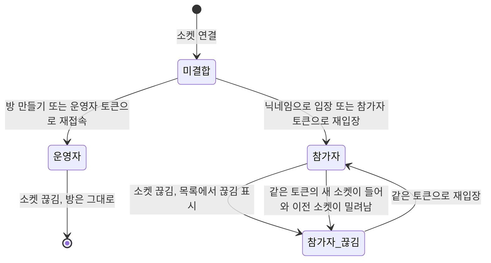
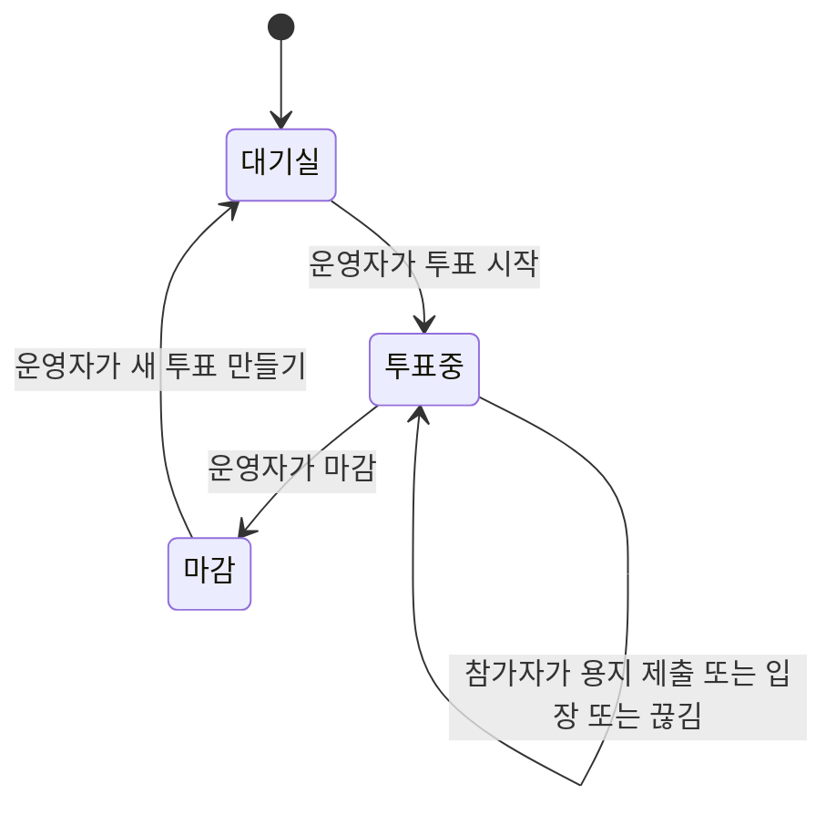

# 익명 투표 웹앱 — 플랜

- 최종 갱신: 2026-11-16
- 상태: 2단계(투표 진행) 완료, 3단계(쓰기 모드) 대기
- 운영 규칙: 결정이 바뀌면 이 파일의 해당 Decision을 고치고, 맨 아래 "변경 이력"에 한 줄 남긴다.

## 1. 무엇을 만드나

운영자가 방을 만들고, 참가자가 QR 또는 4자리 코드로 폰에서 입장한다. 운영자가 투표(제목, 용지 유형, 익명/기명)를 정해 시작하면 참가자는 폰에서 종이 용지에 투표하고, 용지를 접어 투표함에 넣는 연출과 함께 제출한다. 운영자가 마감하면 용지를 한 장씩 펼쳐 확인한다. 운영자 폰과 대화면 모두에서 볼 수 있다.

사용 상황: 한 공간에 모인 30~50명(수업, 회의, 모임). 운영자 노트북을 프로젝터에 연결하거나 폰으로 진행한다.

## 2. Decisions

상태: 확정 / 제안(확인 필요)

### 용지와 투표
- **D-01 용지는 두 종류** (확정): 자유 기재형(쓰기 또는 타이핑)과 객관식(운영자가 정한 보기 2~8개, 단일 선택). 복수 선택과 "기타 직접 쓰기"는 1차에서 제외.
- **D-02 한 방에서 투표 여러 번** (확정): 순서대로 진행하고 동시에 열리는 투표는 하나. 매 투표마다 제목, 용지 유형, 익명/기명을 새로 정한다.
- **D-03 쓰기와 타이핑은 둘 다 허용, 참가자가 전환** (확정): 운영자가 제한하는 옵션은 없다.
- **D-04 제출 규칙** (확정): 마감은 운영자 수동. 제출 후 수정과 취소 불가(1인 1표). 빈 용지 제출 불가. 제출 직전에 "제출하면 고칠 수 없어요" 확인 한 단계. 타이머와 자동 마감은 1차에서 제외.

### 방과 참가자
- **D-05 입장** (확정): 운영자 화면의 QR 또는 4자리 방 코드로 입장하고 닉네임을 입력한다. 계정은 만들지 않는다. 대기실에는 참가자 닉네임이 실시간으로 뜬다.
- **D-06 운영자** (확정): 계정 없이 호스트 토큰으로 식별하고 새로고침해도 유지한다. 투표에는 참여하지 않는다.
- **D-07 참가자 관리와 접속 안정성** (확정): 폰 재접속 시 참가자 토큰으로 자리와 작성 중 초안을 복구한다. 투표가 열린 동안 늦게 입장해도 참여할 수 있다(진행 현황의 분모는 현재 참가자 수). 방 안에서 닉네임 중복 불가, 운영자가 참가자를 내보낼 수 있다. 4자리 코드는 조합이 1만 개라서, 진행 중인 방끼리 코드가 겹치지 않게 하고 틀린 코드를 반복 입력하면 잠시 막는다.

### 익명/기명과 공개
- **D-08 익명의 정의** (수정됨, 확정): 익명이냐 기명이냐는 공개 단계에서 용지와 결과에 닉네임을 표시하느냐의 차이다. 서버는 익명이어도 작성자를 저장하고 운영자는 누가 썼는지 알 수 있다(D-27). 기명이면 용지 하단에 닉네임이 서명처럼 찍히고, 익명이면 어떤 공개 화면에도 닉네임이 나오지 않는다. 모드는 투표 시작 후 바꿀 수 없다. 참가자 폰에는 쓰기 전에 모드 배지를 크게 표시한다. 문구는 "공개 화면에 이름이 표시되지 않아요" 수준으로 정확하게 쓰고, "완전 익명"이라고 단정하지 않는다.
- **D-09 용지 공개 순서는 항상 무작위** (확정): 제출 순서로 보여주면 누가 먼저 냈는지로 추측할 수 있다.
- **D-10 진행 현황** (확정): 운영자 화면에는 "제출 32/45"와 미제출자 닉네임 목록을, 대화면에는 숫자만 보여준다. 마감 전에는 용지 내용을 누구도 볼 수 없다.

### 결과 확인
- **D-11 결과 확인 흐름** (확정): 마감하면 접힌 용지 더미가 나오고, 탭, 스페이스, 방향키로 한 장씩 펼친다. 이전과 다음으로 넘길 수 있다. 자유 기재형은 "전체 공개" 없이 한 장씩만 확인한다.
- **D-12 객관식 결과** (수정됨, 확정): 기본은 한 장씩 공개한다. "전체 공개"를 누르면 보기별 득표 그래프를 보여준다. 한 장씩 공개하는 동안에는 누적 막대를 띄우지 않는다.
- **D-13 대화면 전용 링크는 1차에 포함** (수정됨, 확정): 운영자 화면의 "대화면 열기"에서 링크와 QR을 만든다. 보기 전용이고, 방마다 대화면 토큰으로 막아 방 코드만으로는 들어올 수 없다. 여러 대화면이 동시에 접속해도 된다. 대기실에는 입장 QR과 참가자 목록, 투표 중에는 제목과 진행 숫자, 결과에서는 운영자가 펼치는 용지가 동기화되어 나온다. 운영자 화면은 폰 세로와 대화면 가로 양쪽에 맞게 반응하고 전체화면 버튼을 둔다.
- **D-14 대화면 가리기** (확정): 운영자 화면에 토글을 둔다. 가림 상태에서는 운영자 화면에는 용지가 보이고 대화면에는 접힌 용지만 보인다. 해제하면 공개된다.

### 입력과 연출
- **D-15 쓰기 모드** (확정): 용지는 세로 3:4 고정(폰과 대화면에서 같은 모양으로 보이게). 검정 펜(굵기 2단계), 지우개, 되돌리기, 전체 지우기. 글씨는 이미지가 아니라 획 좌표로 저장하고 내보낼 때 이미지로 바꾼다. 손가락과 스타일러스 모두 지원.
- **D-16 타이핑 모드** (확정): 최대 200자, 같은 용지 위에 손글씨체 웹폰트(나눔펜 계열)로 표시. 모드별 초안을 따로 보존하고, 제출은 그 순간 선택된 모드의 내용만 들어간다. 용지 하나에 한 모드만 담긴다.
- **D-17 객관식 용지** (확정): 보기가 손글씨체로 적혀 있고, 탭하면 동그라미가 그려지는 애니메이션이 나온다. 제출 연출은 자유 기재형과 같다.
- **D-18 용지와 애니메이션** (확정): 크림색 종이에 은은한 괘선과 가장자리 그림자. 접기는 가로 반, 세로 반으로 두 번 접고 위로 올라가 투표함 틈으로 들어가며, 투표함 숫자가 올라가고 짧게 진동한다. 효과음은 넣지 않는다. 펼치기는 투표함에서 꺼내 중앙으로 확대되며 두 번 펼쳐지는, 접기의 역순이다. 모션 줄이기 설정을 켠 기기에서는 간소화한다.

### 데이터
- **D-19 저장은 서버 메모리만** (확정): DB는 쓰지 않고 방은 마지막 활동 후 일정 시간 뒤 자동 삭제한다. 서버가 재시작되면 진행 중인 방은 사라진다. 삭제 시간은 마지막 활동 후 6시간.
- **D-20 내보내기** (수정됨, 확정): 투표 하나 단위로 PDF와 CSV를 제공한다. PDF에는 제목, 날짜, 익명/기명, 객관식 집계가 들어가고 용지가 한 장씩 이미지로 이어진다. CSV에는 타이핑 내용과 객관식 선택을 담는다. 익명 투표는 닉네임을 넣지 않고 기명 투표는 넣는다. 방을 닫거나 자동 삭제되기 전에 "아직 내보내지 않은 투표가 있어요" 경고를 띄운다.

### 기술과 진행
- **D-21 기술 스택** (확정): TypeScript로 프런트(React + Vite)와 서버(Node + WebSocket)를 만들고, 서버 하나가 프런트까지 서빙해 한 곳에 배포한다. 손글씨는 Pointer Events 캔버스, 애니메이션은 CSS 3D와 Framer Motion.
- **D-22 개발 중 폰 테스트** (확정): 노트북에서 서버를 돌리고 `cloudflared` 같은 터널로 임시 주소를 만들어 실제 폰으로 접속한다.
- **D-23 배포는 Render 무료 플랜** (확정): 유휴 시 잠들어도 사용 시점에는 문제없다고 판단. 위험: 잠들거나 재시작되면 메모리의 방이 사라진다. 대응: 행사 전에 주소를 먼저 열어 깨워 두고, 배포 단계에서 유휴 후 동작을 직접 확인한다.
- **D-24 검증** (확정): 서버는 Vitest로 "익명 투표에서 대화면으로 보내는 데이터에 닉네임이 없다", "중복 제출이 막힌다", "방 코드를 반복해서 틀리면 막힌다"를 먼저 테스트로 고정한다. 화면은 Playwright로 운영자 1명, 모바일 크기 참가자 여러 명, 대화면 1개를 동시에 띄워 입장부터 펼치기까지 돌리고, 접기와 펼치기 애니메이션은 스크린샷으로 확인한다.
- **D-25 pstack 사용** (확정): 구현 전에 `pstack:architect`로 타입과 모듈 구조를, `pstack:statechart`로 방과 투표의 상태 전이를 먼저 고정한다. 서버는 `pstack:tdd`, UI와 애니메이션은 직접 보며 다듬고, 각 단계가 끝날 때마다 리뷰를 따로 한 번 돌린다.
- **D-26 플랜 운영** (확정): 이 파일에 결정을 Decision으로 남기고, 바뀔 때마다 갱신한다.
- **D-29 디자인은 A안(투표소)으로 간다** (확정): 구현 전에 디자인 가안 3개를 먼저 만들어 봤고, 사용자가 A안을 골랐다. B와 C에서 가져오는 것은 없다. 가안 목업은 참고용으로 `디자인가안/`에 남긴다. 아래는 가안 제작 기록이다. `디자인가안/` 폴더에 정적 HTML 목업 3개를 만들었다. `디자인가안/index.html`을 열면 된다. 서버 없이 화면만 있고, 용지에 직접 쓰기와 타이핑 전환, 객관식 동그라미, 제출 접기 연출, 한 장씩 펼치기, 익명/기명 미리보기를 눌러 볼 수 있다. 세 가안 모두 D-18(크림색 용지, 두 번 접기, 투표함, 진동, 효과음 없음)을 지킨다. 가안마다 다른 것은 색, 글꼴, 투표함, 운영자 화면 밀도, 시그니처 연출이다. 4단계에서 impeccable로 `DESIGN.md`를 만든다.
  - **A 투표소**: 녹색 안내판과 굵은 고딕, 명부에 인주 도장, 철제 투표함, 밝은 화면.
  - **B 쪽지**: 군청색 게시판, 마스킹테이프로 붙인 용지, 둥근 컨트롤, 노란 나무 투표함.
  - **C 개표장**: 어두운 화면, 용지 한 장에만 조명, 객관식은 正 자 집계, 붉은 칠기 투표함.
  - **주의**: impeccable 엔진을 GitHub에서 내려받지 못해서 방향 추첨, 결정 페이지, 최종 리뷰어는 실행되지 않았다. 방향 3개는 플랜의 결정(D-18 등)에서 직접 도출했고, 렌더링은 Edge와 Playwright로 직접 확인했다. 엔진이 되면 4단계 시작 때 다시 시도한다.
- **D-30 운영자 화면은 폰과 노트북 모두 쓸 수 있게 반응형** (확정): 운영자는 폰이 아니라 노트북으로 진행할 수도 있다. 폰(세로, 약 600px 미만)은 가안 A의 목업처럼 한 열로, 위에 앱바, 가운데 스크롤 영역, 아래에 고정 액션 바를 둔다. 노트북(약 1024px 이상)은 두 열로, 왼쪽에 투표 설정과 현재 투표, 오른쪽에 참가자와 제출 현황(명부)을 놓고, 마감하기와 대화면 열기는 상단 바에 둔다. 그 사이 폭(태블릿)은 한 열에 넓은 여백으로 처리한다. 모든 폭에서 터치와 키보드(방향키, 스페이스)가 같은 일을 한다. 노트북 화면을 프로젝터에 그대로 연결하는 경우가 있으므로 D-27의 "작성자 보기" 기본 숨김이 노트북 화면에도 적용된다. 목업은 폰만 있으니 노트북 화면은 1단계 구현 중에 직접 만들고 브라우저로 확인한다.
- **D-31 1단계 구조: 서버가 방 상태를 갖고 역할별 스냅샷을 보낸다** (확정): 한 패키지에 `shared/`(전송 규약과 닉네임 규칙), `server/`(방 도메인과 WebSocket), `web/`(React + Vite)를 둔다. 방 상태는 서버 메모리의 `RoomStore`가 단독으로 소유한다. 도메인 함수(`createRoom`, `join`, `setConnected`, `viewFor`)는 시계와 난수를 주입받는 순수 함수라서 소켓 없이 테스트한다. 클라이언트는 상태가 바뀔 때마다 서버가 보내는 스냅샷(`view`)을 그대로 그리고, 스냅샷은 `viewFor(room, viewer)` 한 곳에서만 만든다. 익명 투표에서 닉네임을 숨기는 규칙(D-08, D-24)이 나중에 이 한 함수에만 들어가게 하려는 구조다. 전송은 WebSocket 한 줄기에 JSON 메시지이고, 양쪽 끝에서 zod로 검증한다. 토큰은 운영자와 참가자 모두 서버가 발급하고 브라우저 `localStorage`에 저장해 새로고침과 재접속에서 자리를 복구한다. 방 코드 4자리는 진행 중인 방끼리 겹치지 않게 뽑는다. 방 코드 추측 방어와 자동 삭제는 6단계에서 넣는다.
  - **버린 후보 1, 변경 이벤트만 보내는 방식**: 재접속 때 이벤트를 다시 재생해야 하고 서버와 클라이언트에 같은 상태 전이가 두 벌 생겨 소유자가 둘이 된다.
  - **버린 후보 2, 방마다 가변 객체와 구독자 목록**: 누구에게 무엇을 보여줄지가 구독 코드에 흩어져서 익명 규칙을 한 곳에서 시험하기 어렵다.
  - **하지 않은 것**: 설계 후보를 여러 모델로 돌리는 arena와 TLA+ 상태 검증(statechart). 뼈대가 작아서 비용 대비 이득이 작고, statechart는 mise와 Java를 내려받아야 하는데 이 환경에서 막혀 있다. 대신 6번 절의 손으로 그린 상태 전이를 테스트로 고정한다.
- **D-32 코드는 GitHub 저장소 `taeho-0128/vote`에서 관리한다** (확정): 공개 저장소이고 지금은 비어 있다. 로컬에 git을 초기화하고 `origin`을 연결했다. 커밋과 푸시는 필요할 때 알아서 한다(사용자 승인). 단계가 끝나고 실제로 검증한 시점에 작은 커밋으로 나눠 올리고, 검증 안 된 작업과 강제 푸시는 올리지 않는다. 공개 저장소라서 이 플랜과 디자인 가안도 누구나 볼 수 있다. `.audit/`, `node_modules/`, `dist/`, `e2e/out/`은 올리지 않는다.
- **D-33 투표 수명주기와 용지 데이터 (2단계)** (확정): 방의 단계는 `lobby`(투표 없음), `voting`(열린 투표 하나), `closed`(마감, 결과 대기) 셋이고, 전이는 운영자만 일으킨다. `startVote`는 lobby에서만, `closeVote`는 voting에서만, `dismissVote`("새 투표 만들기")는 closed에서만 된다. 닫힌 투표는 용지와 함께 방 안에 쌓아 둔다(6단계 내보내기용). 투표 설정은 제목(1~60자), 용지 유형(자유 기재 또는 객관식 보기 2~8개, 보기마다 1~30자이고 중복 불가), 익명/기명이다. 용지 내용은 `text`(타이핑, 1~200자, 줄바꿈 허용)와 `choice`(보기 번호) 두 종류이고, 3단계에서 `ink`(손글씨 획)가 같은 자리에 더해진다. 참가자 1명은 투표당 용지를 한 장만 낸다. 낸 뒤에는 고칠 수 없다(D-04). 늦게 입장한 사람도 투표가 열려 있으면 낼 수 있다. 제출, 마감, 새 투표 명령은 `voteId`를 같이 보내서, 늦게 도착한 옛 명령이 새 투표에 적용되지 않게 한다. 서버는 용지마다 작성자를 저장한다(D-27). 2단계의 스냅샷에는 용지 내용이 어디에도 실리지 않고 개수만 실린다(D-10). 운영자의 스냅샷만 참가자별 `submitted`를 갖고(미제출자 목록용), 참가자와 대화면에는 실리지 않는다. 검증 규칙(제목, 보기, 용지 본문)은 `shared/vote.ts` 한 곳에 두고 서버와 화면이 같이 쓴다.
- **D-27 작성자 저장과 운영자 확인** (확정): 서버는 익명 투표에서도 용지의 작성자를 저장한다. 운영자는 누가 썼는지 알 수 있다. 익명 모드에서 작성자 닉네임은 대화면과 다른 공개 화면으로 보내는 데이터에 실리지 않는다. 익명 투표의 운영자 화면은 기본으로 작성자를 숨기고 "작성자 보기" 토글을 켰을 때만 보여준다(기명은 항상 보인다). 운영자 노트북을 프로젝터에 그대로 연결하면 운영자 화면이 곧 공개 화면이 되기 때문이다.
- **D-28 디자인은 impeccable로 보강** (확정): 개발 4단계(용지와 접기 애니메이션), 5단계(결과 확인과 대화면), 6단계(반응형 정리)에서 impeccable 스킬로 디자인을 잡고 보강하는 과정을 매번 묻지 않고 알아서 진행한다. 순서는 `shape`(방향 정리) → 구현 → `critique`(비평) → `polish`와 `animate`(다듬기) → `adapt`(폰 세로와 대화면 가로) → `harden`(예외 상태). 첫 실행 때 이 플랜에서 `PRODUCT.md`와 `DESIGN.md`를 만든다. 운영자 화면은 Operate(과제 수행형) 기준으로 읽기 쉬움과 일관성을 우선하고, 용지와 접기 연출은 표현에 힘을 준다. 렌더링된 화면을 폰 크기와 대화면 크기에서 직접 보고 확인한다. 단, 동작이나 범위를 바꾸는 디자인 변경(기능 추가, 문구의 의미 변경, 이 플랜의 Decision과 충돌)은 임의로 하지 않고 플랜을 먼저 고친다.

## 3. 개발 순서

- [x] 1. 뼈대: 방 만들기, QR와 4자리 코드 입장, 대기실 실시간 목록, 호스트 토큰. 확인: 서버 테스트 44개, 타입 검사, 빌드 통과. 실제 서버(`e2e/lobby-real.mjs`)에서 운영자 1명과 폰 폭 참가자 3명이 입장, 중복 닉네임 거부, 끊김 표시, 새로고침 복구, 운영자 토큰 없는 접근 차단을 확인했고 390, 768, 1280, 1920px에서 가로 넘침이 없다. 확인하지 못한 것: 실제 폰 카메라로 QR 스캔, 클립보드 복사(http 환경).
- [x] 2. 투표 진행: 투표 만들기, 시작, 타이핑 제출, 마감, 객관식. 확인: 테스트 99개(서버 변이 확인 포함), 타입 검사, 빌드 통과. 가짜 서버 화면 확인 506개 통과. 실제 서버(`e2e/vote-real.mjs`)에서 운영자 1명과 폰 폭 참가자 3명이 자유 기재 익명 투표와 객관식 기명 투표를 시작, 제출, 마감, 새 투표까지 돌렸다. 운영자 화면의 제출 수와 명부 표시, 참가자 새로고침 뒤 제출 상태 유지, 안 낸 사람에게 보이는 안내, 운영자 새로고침 복구, 네 폭에서 가로 넘침 없음을 확인했다. 아직 없는 것: 손글씨(3단계), 접기 연출(4단계), 결과 펼치기(5단계).
- [ ] 3. 쓰기 모드: 손글씨 캔버스, 획 저장, 쓰기와 타이핑 전환
- [ ] 4. 접기 애니메이션: 용지 디자인, 접기와 투표함 투입
- [ ] 5. 결과 확인: 한 장씩 펼치기, 객관식 전체 공개 그래프, 대화면 링크, 가리기 토글
- [ ] 6. 마무리: 내보내기, 방 자동 삭제와 경고, 코드 추측 방어, 반응형과 전체화면
- [ ] 7. 배포: Render 무료

## 4. 확인 대기

없음. 이전에 제안으로 남겼던 두 건은 사용자가 구현 진행을 지시하면서 추천안 그대로 확정했다. 작성자 표시는 D-27에, 익명 투표의 내보내기에서 닉네임 제외는 D-20에 반영돼 있다.

## 5. 1단계 연결 상태 전이

모델 검증 없이 손으로 그린 것이다. 소켓 하나는 처음에 아무 역할도 없고, 한 번 역할을 얻으면 그 소켓에서는 바꿀 수 없다(`already_bound`).

2단계에서 더해지는 방의 단계 전이다. 마찬가지로 손으로 그렸고 모델 검증은 하지 않았다.

## 6. 변경 이력

- 2026-11-16: 최초 작성.
- 2026-11-16: D-08 익명의 정의를 "서버가 작성자를 저장하지 않음"에서 "공개 화면에 닉네임을 표시하지 않음"으로 변경.
- 2026-11-16: D-12 객관식 결과를 "펼치며 막대가 오른다"에서 "한 장씩 공개, 전체 공개 시 그래프"로 변경.
- 2026-11-16: D-13 대화면 전용 링크를 2차에서 1차로 승격.
- 2026-11-16: D-20 내보내기를 1차 범위에 포함.
- 2026-11-16: D-27 추가. 서버가 익명 투표에서도 작성자를 저장하고 운영자가 알 수 있게 함(이전 제안이던 "작성자 저장 안 함"은 폐기). D-24의 익명성 테스트 대상을 "대화면으로 보내는 데이터"로 조정.
- 2026-11-16: D-28 추가. 4~6단계 디자인을 impeccable로 알아서 보강하기로 함.
- 2026-11-16: D-29 추가. 구현 전에 디자인 가안 3개(A 투표소, B 쪽지, C 개표장)를 정적 목업으로 만들어 먼저 보기로 함.
- 2026-11-16: D-29를 "가안 제작"에서 "A안(투표소) 선택"으로 바꿈. 확인 대기 두 건(작성자 표시, 익명 내보내기)을 추천안으로 확정. D-30 추가(운영자 화면 폰과 노트북 반응형). 1단계 구현 시작.
- 2026-11-16: D-33 추가. 2단계 투표 수명주기(대기실, 투표중, 마감)와 용지 데이터, 검증 규칙을 `shared/vote.ts`로 통합. 상태 전이 그림 추가. 2단계 구현 시작.
- 2026-11-16: D-32 추가. GitHub 저장소 `taeho-0128/vote`로 관리. 서버 구현 중 받아들인 계약 변경: `tsconfig.json`에 `allowImportingTsExtensions` 추가, `RoomStore`가 `deps`를 공개 필드로 노출, `viewFor`가 호스트와 참가자 뷰를 각각 반환하는 오버로드를 가짐. 서버 쪽에 `deps.ts`, `app.ts`, `testkit.ts`가 추가됨.
- 2026-11-16: D-31 추가. 1단계 구조(서버가 상태를 갖고 역할별 스냅샷 전송), 설계 후보 비교, arena와 statechart를 건너뛴 이유.
- 2026-11-16: D-11에 자유 기재형은 "전체 공개" 없음을 명시. D-19 자동 삭제 시간을 6시간으로 확정.
